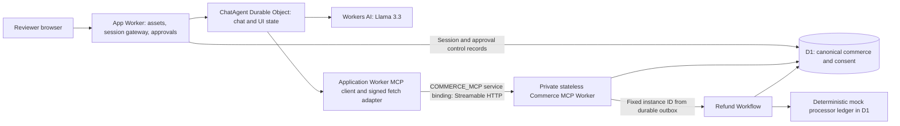

# Customer service agent build plan

Status: **Milestones 1–2 are implemented**; Milestones 3–6 remain planned. Milestone 1 proved the private transport; Milestone 2 adds canonical data, fixtures, and local/demo setup commands. The demo Workers were subsequently deployed and the deployment fix was committed before Milestone 2. Milestone 2 was subsequently pushed, deployed, migrated, seeded, and verified remotely at the user’s request; see section 16. Earlier implementation records describe their state at the time; the Milestone 2 record below supersedes their placeholder/setup notes.

## 1. Objective and agreed scope

Build a customer service demo for the fictional **Example Parcel Shop** that demonstrates authorization, explicit consent, reliable state transitions, and safe simulated money movement. A reviewer can inspect orders, cancel eligible orders, request full refunds, change an eligible order's shipping address, and create support tickets.

Confirmed decisions:

- Each public session gets an isolated copy of the six-persona commerce fixture in D1. Fixture IDs are stable within a server-generated namespace. Reviewers cannot consume one another's eligible orders.
- Each session is permanently bound to one server-selected synthetic persona. A welcome-screen persona choice is only an allowlisted selection hint; the server resolves it and issues the identity. In-chat requests or tool arguments attempting to change identity are rejected, identity stays unchanged, and the UI directs the reviewer to **Start new session**.
- **Start new session** creates a fresh identity, namespace, chat, and fixtures. It invalidates all unexecuted approvals in the previous session. No history or approval transfers. Already accepted refund Workflows continue under their original customer and namespace.
- Every business mutation requires clicking an action-specific **Approve** button. Chat text such as “yes” is insufficient. Approvals expire five minutes after issuance. Rejected, expired, edited, or stale proposals need new approval; accepted work can finish after expiry.
- Simulate all payments and refunds. Use EUR and integer minor units. No real provider, card data, email delivery, or external support integration.
- `cancel_order` stops fulfillment only; it never refunds or changes payment status. After cancelling a paid order, show “Order cancelled; payment has not been refunded” and offer a separately approved `refund_order` action.
- A full refund is eligible only for a **paid** order whose fulfillment status is **cancelled, shipped, or delivered**. There is one logical refund per order, potentially with multiple separately approved attempts after confirmed failures.
- Unknown outcomes stay pending and reconcile under the same attempt and key. Only definitive confirmation that no refund occurred permits a new approved attempt, with a new attempt key and Workflow instance ID under the existing refund.
- Address changes apply only to unshipped orders, paid or unpaid, with no refund in progress or completed. Never update a saved profile address.
- Shipping states are fixed fixtures; no autonomous fulfillment simulator. Escalation creates a ticket in D1. Business outcomes are deterministic; model prose is not guaranteed identical.

Session issuance, fixture initialization, proposal/audit persistence, and recovery of already accepted work are infrastructure operations. They do not give the model permission to mutate commerce. A support ticket is never created automatically as a side effect of a failed refund.

## 2. Repository assessment and documentation baseline

Inspected `package.json`, `wrangler.jsonc`, `vite.config.ts`, `tsconfig.json`, `README.md`, `src/server.ts`, `src/app.tsx`, and `src/client.tsx` before proposing changes.

| Existing starter | Planned adaptation |
| --- | --- |
| React/Kumo UI in `src/app.tsx`, entry in `src/client.tsx` | Retain structure; add welcome/persona screen, order summaries, approval cards, refund progress, and Start new session |
| `ChatAgent extends AIChatAgent<Env>` from `@cloudflare/ai-chat` | Retain streaming, persisted messages, recovery, and bounded history |
| `agents` declared `^0.17.4`; `@cloudflare/ai-chat` `^0.9.3`; AI SDK `^6.0.197`; `workers-ai-provider` `^3.2.1` | Validate exact mutually compatible releases, then pin and commit a lockfile during implementation |
| Starter uses `@cf/moonshotai/kimi-k2.7-code` | Prefer documented Llama 3.3 model below |
| Random weather/calculation/timezone/scheduling/image demos | Replace with the eight commerce tools and focused text chat |
| Public callable `addServer`/`removeServer`, arbitrary MCP URL UI, OAuth popup handling | Remove from the public application; reach commerce only through the `COMMERCE_MCP` service binding and a binding-backed MCP HTTP transport |
| Unguarded `routeAgentRequest` | Authenticate HTTP, WebSocket upgrades, history access, and callable methods before routing to the bound agent |
| Root Wrangler file: AI binding, assets, ChatAgent DO, `v1` SQLite migration | Preserve the class/migration; extend configuration explicitly per environment |
| Vite plugins: agents, React, Cloudflare, Tailwind; deploy is `vite build && wrangler deploy` | Retain build pipeline and Wrangler deployment; do not introduce Pages or another platform |

Official documentation retrieved during planning on 2026-10-20:

- [Agents chat agents](https://developers.cloudflare.com/agents/communication-channels/chat/chat-agents/): supported chat persistence/streaming and approval integration; the inspected starter is the concrete integration baseline.
- [MCP handler API](https://developers.cloudflare.com/agents/model-context-protocol/apis/handler-api/): current stateless server path is `createMcpHandler` from `agents/mcp/server`, using MCP SDK v2. Documentation names `@modelcontextprotocol/server@2.0.0` and says to match the installed Agents release. `McpAgent` is deprecated; do not add an MCP Durable Object.
- [MCP transport](https://developers.cloudflare.com/agents/model-context-protocol/protocol/transport/): use Streamable HTTP. [MCP client API](https://developers.cloudflare.com/agents/model-context-protocol/apis/client-api/): authenticated headers are supported; client APIs and package exports must match the selected release.
- Service-binding revision: retrieved [HTTP service bindings](https://developers.cloudflare.com/workers/runtime-apis/bindings/service-bindings/http/), [local multi-Worker development](https://developers.cloudflare.com/workers/local-development/multi-workers/), [Vite auxiliary Workers](https://developers.cloudflare.com/workers/vite-plugin/reference/api/), [Wrangler routing/environment options](https://developers.cloudflare.com/workers/wrangler/configuration/), and the upstream [MCP SDK v2 transport API](https://ts.sdk.modelcontextprotocol.io/v2/api/@modelcontextprotocol/client/client/streamableHttp.html) and [transport source](https://github.com/modelcontextprotocol/typescript-sdk/blob/main/packages/client/src/client/streamableHttp.ts). These establish the supported custom-fetch path described below; no runtime compatibility test was run in this planning stage.
- [Llama 3.3 model](https://developers.cloudflare.com/workers-ai/models/llama-3.3-70b-instruct-fp8-fast/) and [Workers AI SDK integration](https://developers.cloudflare.com/workers-ai/configuration/ai-sdk/): `@cf/meta/llama-3.3-70b-instruct-fp8-fast` remains documented with function calling; retain `createWorkersAI` and an AI binding.
- [D1 setup](https://developers.cloudflare.com/d1/get-started/), [migrations](https://developers.cloudflare.com/d1/reference/migrations/), [prepared queries and transactional batches](https://developers.cloudflare.com/d1/worker-api/d1-database/), [SQL import](https://developers.cloudflare.com/d1/best-practices/import-export-data/), and [D1 CLI](https://developers.cloudflare.com/workers/wrangler/commands/d1/): bindings, ordered SQL migrations, local/remote SQL-file execution, bound values, and rollback on batch statement failure are the database baseline.
- [Workers static assets](https://developers.cloudflare.com/workers/static-assets/), [Vite plugin](https://developers.cloudflare.com/workers/vite-plugin/), [multiple Workers](https://developers.cloudflare.com/workers/local-development/multi-workers/), [Wrangler configuration](https://developers.cloudflare.com/workers/wrangler/configuration/), [secrets](https://developers.cloudflare.com/workers/configuration/secrets/), and [GitHub Actions](https://developers.cloudflare.com/workers/ci-cd/external-cicd/github-actions/) cover build/configuration and delivery.
- [Workflow API](https://developers.cloudflare.com/workflows/build/workers-api/) supplies `WorkflowEntrypoint`, steps, and instance creation. Apply [Workflow rules](https://developers.cloudflare.com/workflows/build/rules-of-workflows/) and [Durable Object rules](https://developers.cloudflare.com/durable-objects/best-practices/rules-of-durable-objects/): replay-safe steps, durable state, and explicit coordination across awaited work.

The current docs are newer than the starter's declared Agents version. Do not assume a new import works in `^0.17.4`; the first implementation milestone proves a compatible Agents/chat/MCP/AI SDK combination. No package installation or runtime API call was performed in planning.

## 3. Architecture and responsibilities

Use **two deployed Workers**, one D1 database per deployed environment, a ChatAgent Durable Object namespace, and one refund Workflow definition. Hosting the Workflow class in the commerce Worker does not make the MCP HTTP server stateful: durable execution belongs to Workflows and commerce state belongs to D1.



- **App Worker:** serves Vite-built static assets and same-origin session/approval endpoints; issues opaque browser session cookies; maps them to immutable server identity; gates all agent routes; creates server-trusted proposals. Its `COMMERCE_MCP` service binding is available in the Application Worker's ChatAgent environment as well as its gateway. The request-scoped MCP client uses a custom fetch adapter backed by that binding, including protocol handshake and tool requests. D1 access is limited by application code to sessions, fixture provisioning, approvals, and scoped audit/control reads. Commerce changes go through the MCP boundary. Cloudflare D1 bindings are not table-level authorization; test this separation explicitly.
- **ChatAgent:** one DO per session, stores conversation, proposal presentation IDs, streaming/recovery metadata, and UI state. Holds no canonical customer/order/refund records. It is not a cross-order lock. Do not infer business success from a saved chat message.
- **Commerce MCP Worker:** private default `fetch` handler reached through the app's HTTP service binding, with request-scoped authenticated context and stateless Streamable HTTP exposing exactly eight tools. No public route, custom domain, workers.dev address, or preview URL is enabled. Owns canonical ownership/eligibility validation and commerce transactions. Binding reachability grants no customer authority: verify signed context on every request, then enforce the same ownership/approval rules. Never store caller identity in a module global or MCP connection session. Scheduled dispatch repair and the refund Workflow remain independent platform invocations, not additional public MCP callers.
- **Refund Workflow:** exported from the commerce Worker, runs one instance per refund attempt. It reads the persisted accepted attempt and uses its immutable owner, amount, and key. It does not call the model or wait for another approval.
- **D1:** source of truth for commerce, session identity/revocation, action authorization, audit events, refund attempts, dispatch records, and the mock processor ledger. All reads use the server namespace and ownership scope.

Recommend Worker static assets over Pages because the starter already deploys React assets and the agent backend together, keeps browser traffic same-origin, and avoids a second frontend project. Add `/api/*` to `assets.run_worker_first` alongside `/agents/*`; unknown API/auth paths return JSON errors rather than the SPA. Keep asset routing tested against the Vite-generated deployment configuration.

Proposed structure, to create only during implementation:

```text
src/
  server.ts                    # ChatAgent export and gated app router
  app.tsx                      # existing UI adapted to commerce
  client.tsx, styles.css        # existing entry and styling
  session.ts                   # issuance, immutable persona, replacement/revocation
  approvals.ts                 # proposal canonicalization and button endpoint
  commerce-client.ts           # service-binding fetch, MCP client, consent adapter
  components/                  # order, approval, refund progress UI
workers/commerce/
  src/index.ts                 # stateless MCP handler, auth, scheduled dispatch repair
  src/tools.ts                 # exactly eight tool registrations
  src/repository.ts            # parameterized commerce queries and transactions
  src/refund-workflow.ts       # WorkflowEntrypoint
  src/mock-processor.ts        # deterministic ledger and reconciliation
  wrangler.jsonc
shared/
  contracts.ts, policy.ts      # strict schemas, safe error codes, versioned policy
migrations/
  0001_commerce.sql
  0002_consent_and_audit.sql
  0003_refund_execution.sql
fixtures/
  seed-v1.sql                 # idempotent fixture catalog and local reference namespace
  reset-local.sql             # explicit local-only reset
scripts/
  seed-demo.ts                # explicit fixture-version bootstrap, no automatic reset
  verify-fixtures.ts
tests/                        # unit, Worker integration, Workflow replay, browser tests
.github/workflows/ci.yml, deploy-demo.yml
wrangler.jsonc, vite.config.ts, env.d.ts, PLAN.md, PROMPTS.md
```

Keep one root package/lockfile and a secondary Worker config rather than restructuring the starter into a large monorepo.

## 4. Identity, authorization, and approval protocol

### Browser and session identity

1. The welcome screen offers six documented personas. `POST /api/sessions` accepts only an allowlisted persona selection and CSRF token, not a customer/session ID to trust. The server chooses the mapped fixture customer, generates a random opaque session token, stores only its hash, and provisions a new namespace transactionally from the active fixture version. It binds an immutable customer ID and chat DO name.
2. Use `Secure`, `HttpOnly`, `SameSite=Strict`, path `/` cookies. Validate Origin and CSRF on state-changing endpoints and WebSocket upgrade Origin. Do not put session secrets in URLs or model messages. Only the gateway derives the DO name; user-selected agent names must not reach arbitrary objects.
3. Refresh reconnects the same bound session; **Start new session** is an authenticated, idempotent replacement request. It revokes the previous session's mutation eligibility/approval epoch, invalidates its unexecuted approvals, creates the replacement, and returns the new cookie. Require server-controlled lineage and a replacement request key so duplicate clicks do not create divergent identities. If provisioning fails, the previous session may remain revoked; show a safe restart option rather than re-enabling stale approvals.
4. Old sessions may retain read-only access to their own accepted refund status while their original credential is valid. Do not carry that credential into a different persona's new session. An already open original tab may display its accepted outcome after reconnect/auth checks; a fresh namespace for the same fixture persona cannot access the previous namespace merely by matching its customer ID. No cross-session recovery feature is required for this assignment.
5. The visible persona label comes from server state. In-chat identity-switch requests get an explanation and Start new session instruction; strict tool schemas reject identity fields. Audit the attempt without changing the identity.

### Trusted context crossing the MCP boundary

Use only `env.COMMERCE_MCP.fetch(request)` for app-to-commerce HTTP. Construct requests with the fixed logical URL `https://commerce-mcp.internal/mcp`, as service-binding HTTP requires an absolute URL. Its hostname is request metadata, not DNS, a public endpoint, or the binding target. The Wrangler `services[].service` field selects the Worker; changing the URL alone never makes an MCP client use a binding. No global-fetch/public-network fallback, arbitrary URLs, user-specified headers, or browser-to-MCP calls. Reject redirects and unexpected origin/path before dispatch. Disable permissive CORS; the app exposes neither a generic MCP proxy nor a debug route bypassing session/consent checks.

### Verified client choice and smallest transport adapter

Keep Agents SDK/AIChatAgent for chat, and select the **upstream MCP SDK v2 `@modelcontextprotocol/client` request-scoped client with `StreamableHTTPClientTransport`** for commerce HTTP. Its retrieved API defines `StreamableHTTPClientTransportOptions.fetch?: FetchLike`; the source stores this callback and uses it for network requests. This is a verified extension point for a binding-backed fetch, not an assumption about endpoint routing. Pin the exact client/server versions compatible with the selected Agents release during milestone 1; documentation/source verification does not establish that the starter's uninstalled dependency range already exports these APIs.

The retrieved Agents `addMcpServer` reference documents transport type/headers but does not establish a custom-fetch forwarding contract. Do not depend on that convenience connector accepting a function, persisting it, or restoring it after DO hibernation. Use the official SDK transport directly inside `commerce-client.ts`, with the same eight application tool/approval adapters. This bypasses only connector transport plumbing; it does not replace Streamable HTTP with RPC or change tool schemas.

The smallest compatible adapter is a request-local `FetchLike(input, init)` supplied to the SDK transport's `fetch` option:

1. Normalize `input` and `init` into a Web `Request`, preserving the method, body stream, AbortSignal, MCP protocol/Accept/content headers, and any SDK session/resumption headers. Allow only the fixed logical MCP origin/path. Do not buffer and rebuild SSE responses or reimplement JSON-RPC negotiation.
2. Load the immutable session identity from trusted application state, create the signed context below, and set `Authorization: Bearer <signed-context>` after discarding any supplied identity/authorization headers. Never forward a browser Cookie or accept identity headers from model arguments. Use a request-local closure so concurrent customers cannot share headers; refresh context per HTTP request/reconnect rather than persisting expiring credentials.
3. Set redirect handling to manual, call `env.COMMERCE_MCP.fetch(request)`, reject any redirect response, and return the original response stream/status/headers. Forward every protocol request through this path, including initialization/discovery, notifications, tools/list, tools/call, and any GET/resumption/DELETE used by the selected SDK. No OAuth discovery, SSE-transport auto fallback, or outbound global fetch is enabled. A stateless server's unsupported optional GET/DELETE is handled as the SDK documents, not as a reason to use a public endpoint.
4. Close the request-scoped client/transport after consuming the response. Reconstruct it after hibernation; do not serialize a service binding or callback into DO storage. A transport failure returns a safe temporary error and retries only under the existing action/idempotency rules.

If the Agents convenience client cannot carry this hook, the direct SDK client plus this fetch wrapper is the fallback already selected here. No custom protocol parser is needed. If the exact pinned SDK fails the Workers/custom-fetch compatibility gate, stop that milestone and choose a documented compatible SDK release; do not widen access by enabling a public Commerce route.

For each logical MCP operation, the server adapter creates a short-lived signed context using Web Crypto HMAC-SHA256 and environment-specific secret material:

`{ iss, aud: "commerce-mcp:<environment>", sid, namespace_id, customer_id, approval_epoch, scope, iat, exp, jti, action_id? }`.

Use a maximum 60-second context lifetime, fixed issuer/audience/algorithm, key IDs for rotation, and a server-generated nonce. Never expose the signing key or signed context to browser/model/debug UI. These lifetimes are application policy, not Cloudflare quotas. The binding-backed fetch attaches fresh context to each HTTP request, including handshake and reconnect traffic; do not persist expiring tokens in DO connector metadata. The service binding provides internal transport, not customer authentication or consent.

Before any MCP handler dispatch, even over the binding, the MCP Worker verifies the signature, issuer, audience/environment, expiry, allowed scope, and D1 session binding/epoch. Missing/invalid signed context is rejected before protocol dispatch or data access. For accepted-result reads, verify the original authorized session and namespace; for new mutations require a mutation-enabled session. Map only verified context to request-scoped handler auth data. Signing a caller-supplied customer ID is forbidden: identity is loaded from the session record before signing, and checked against that record by MCP. Mutation authorization also requires the exact active D1 approval; possession of a service binding or a valid service token is never sufficient.

Reads filter by `(namespace_id, customer_id)`; order/refund/ticket lookups join to the owned order/customer. A missing ID and another customer's ID produce the same `NOT_FOUND` shape and message, without echoing foreign fields. Client/customer identity is omitted entirely from model tool inputs.

### Proposal, approval, and execution

1. Model tool adapters parse strict input and resolve the owned target through authorized reads. For refunds, classify existing status first so pending/unknown/completed calls do not prompt for approval.
2. For an eligible mutation, create an immutable proposal with a random action ID, canonical normalized arguments, tool name, namespace/customer/session, policy version, target version, server-derived EUR amount, and previous refund attempt/version where relevant. Hash the canonical representation. Proposal creation does not mutate commerce.
3. Display a server-generated escaped approval card: tool/action, order, consequences, amount, exact replacement address, or complete ticket category/subject/body/order reference. Include expiry and Approve/Reject. No hidden model-added fields. Use AI SDK approval UI support as presentation plumbing, not as the authorization authority.
4. Approval endpoint validates session, CSRF, action ownership, digest, current epoch, and server time. Clicking Approve records explicit consent to that exact proposal. A client `approved: true` message or AI tool result cannot fabricate this record.
5. Execute with server-side `action_id` and approval context. MCP independently checks ownership, payload digest, active approval, expiry, version, and current eligibility. Never forward automatically executable mutation tools directly from `getAITools()` into the model without this adapter.
6. Within a transactional D1 batch, claim the unconsumed approval and apply the conditional business write, audit event, result, and refund outbox if needed. Revocation and acceptance serialize in D1. Acceptance winning before session replacement may finish; replacement winning prevents acceptance. Already accepted Workflows do not require the browser approval to remain active afterward.
7. Persist a minimal result under `(namespace_id, action_id)`. Same action/same digest returns that result without another effect; different digest is `ACTION_CONFLICT`. Replays still require authorized session/ownership. A failed original action cannot authorize a newly numbered refund attempt.

A conditional UPDATE affecting zero rows is not a database error. Guard the batch with database-enforced assertions (for example, a NOT NULL acceptance insert from the eligible action/session/order join, plus a final CHECK assertion that exactly one intended business transition occurred). Assertion failure must roll back approval consumption, business state, audit, and outbox together. Do not describe `batch()` alone as solving logical races. Prove this transaction strategy in integration tests before building UI.

Normalize addresses before displaying/hashing, then reject changes rather than silently normalizing differently after approval. New proposals use a fresh five-minute deadline; do not auto-renew expired consent. Rejection is terminal for that proposal. No confirmation is implied by a previous conversation or the model's confidence.

## 5. MCP tool contracts

Expose exactly these eight names. All schemas are strict objects (`additionalProperties: false`), with input/output runtime validation. All strings are Unicode text rendered safely. IDs are 1–64 characters matching the documented fixture/server ID format; no SQL fragments. Money is integer EUR minor units, never floating point. In the schema notation below, bare ID fields are strings satisfying that ID constraint, bare textual fields are strings, `category` uses the ticket category enum, and `replayed` is boolean. Shared type references expand to their complete definition rather than arbitrary objects.

Shared definitions:

- `Address = { recipient: string[1..80], line1: string[1..120], line2?: string[0..120], city: string[1..80], region?: string[0..80], postal_code: string[1..20], country: "PT" }`. This demo accepts synthetic Portuguese addresses only; validate format/length, not deliverability. Do not use real address lookup services.
- `OrderSummary = { order_id, fulfillment_status: "unshipped"|"cancelled"|"shipped"|"delivered", payment_status: "unpaid"|"paid"|"refunded", total_minor: integer, currency: "EUR", version: integer }`.
- `Refund = { refund_id, order_id, amount_minor: integer, currency: "EUR", status: "pending"|"completed"|"failed", attempt_number: integer, outcome: "unknown"|"confirmed_succeeded"|"confirmed_no_refund", retry_requires_approval: boolean, updated_at: ISO8601 }`.
- Success envelope: `{ ok: true, data: T, request_id: string }`. Failure: `{ ok: false, error: { code, message, retryable: boolean }, request_id: string }`. Encode tool-level errors in MCP structured content with `isError: true`; transport authentication failures use safe HTTP 401/403. JSON-RPC parsing errors remain protocol errors.
- Codes: `INVALID_ARGUMENT`, `UNAUTHENTICATED`, `SESSION_REVOKED`, `IDENTITY_SWITCH_DENIED`, `NOT_FOUND`, `NOT_ELIGIBLE`, `APPROVAL_REQUIRED`, `APPROVAL_EXPIRED`, `APPROVAL_REVOKED`, `ACTION_CONFLICT`, `VERSION_CONFLICT`, `RATE_LIMITED`, `TEMPORARILY_UNAVAILABLE`. Never return raw SQL, stack traces, token claims, or foreign-record metadata.
- Trusted mutation execution context, **outside model arguments**: `{ action_id, approval_id, action_digest }`, bound to the verified session and signed context. Normal mutation output includes `{ action_id, replayed: boolean, ...result }`. Unapproved initial calls return `APPROVAL_REQUIRED`; the app displays its immutable proposal, not invented success data.

| Exact tool | Model-visible input | Success data schema | Authorization and eligibility | Relevant failures/replay |
| --- | --- | --- | --- | --- |
| `get_order` | `{ order_id: ID }` | `{ order: OrderSummary & { items: [{ sku, name, quantity: integer, unit_minor: integer, line_minor: integer }], shipping_address: Address, tracking: { carrier: string, tracking_id: string } | null, refund: Refund | null, eligibility: { can_cancel: boolean, can_refund: boolean, can_update_address: boolean, reasons: string[] } } }` | Verified session; order namespace/customer ownership; nested refund must belong to same owned order. Return only required synthetic fields. | Missing/foreign ID → identical NOT_FOUND; invalid ID; transient D1 failure. No write or model authorization inference. |
| `list_customer_orders` | `{ limit?: integer[1..20] = 10, cursor?: string[1..256] }` | `{ orders: OrderSummary[], next_cursor: string | null }` | Customer comes exclusively from trusted context. Stable order-ID ordering; signed cursor binds namespace/customer/filter/last ID. | Tampered or foreign cursor → INVALID_ARGUMENT without data; empty list is success; transient read failure. No customer_id argument. |
| `cancel_order` | `{ order_id: ID }` | `{ action_id, replayed, order: OrderSummary, payment_unchanged: true, notice: string, offer_refund: boolean }` | Owned unshipped order; active exact cancellation approval/version. Set only fulfillment to cancelled and version; never change payment or insert refund. Paid notice explicitly says payment has not been refunded; offer fresh refund action. | Shipped/delivered/cancelled new action → NOT_ELIGIBLE; stale version, missing/revoked approval. Same accepted action returns stored result. Two concurrent actions can cancel only once. |
| `refund_order` | `{ order_id: ID }` | `{ refund: Refund, action_id: ID | null, replayed: boolean, disposition: "accepted"|"status_only"|"retry_accepted" }` | Owned order/refund. Initial or confirmed-failed retry requires paid + cancelled/shipped/delivered and fresh exact approval. Amount is canonical total, not input. One logical refund/order. Pending/unknown/completed returns current status without new approval, attempt, or Workflow. | Unpaid/unshipped → NOT_ELIGIBLE; missing consent for new attempt; stale failed-attempt version; concurrent attempt → current pending status or conflict, never second attempt. Confirmed failed retry reuses refund ID but gets new attempt/key/Workflow. Replay of old action never starts retry. |
| `update_shipping_address` | `{ order_id: ID, address: Address }` | `{ action_id, replayed, order: OrderSummary, shipping_address: Address, profile_address_unchanged: true }` | Owned unshipped order, paid or unpaid; no pending/completed refund and payment not refunded; active exact address approval/version. Order address only. | Invalid/overlong address; foreign order; cancelled/shipped/delivered/refunded; stale version/address digest; same action replay returns stored result. |
| `get_customer_profile` | `{}` | `{ customer: { customer_id: ID, display_name: string, email: string, saved_shipping_address: Address } }` | Select only authenticated namespace/customer. No customer selector; omit payment instruments, internal flags, session secrets, and other personas. | Unauthorized context; unexpected identity field → IDENTITY_SWITCH_DENIED; safe read failure. |
| `create_support_ticket` | `{ order_id?: ID, category: "delivery"|"refund"|"cancellation"|"address"|"other", subject: string[1..120], body: string[1..2000] }` | `{ action_id, replayed, ticket: { ticket_id: ID, order_id: ID | null, category, subject, body, status: "open", created_at: ISO8601 } }` | Owner from trusted context; optional order must belong to same customer/namespace. Explicit approval of complete normalized ticket text. Routing/priority/status assigned by server; no model-supplied assignee, webhook, or external destination. | Foreign order → NOT_FOUND; invalid content/limits; no approval; rate limit; same action returns same ticket. Identical text with a genuinely new approval may create a new ticket; deduplicate retries by action, not by text alone. |
| `get_refund_status` | `{ refund_id: ID }` | `{ refund: Refund }` | Join refund to its owned order using both namespace and customer. Return safe progress/outcome only; no processor keys or Workflow secrets. | Missing/foreign refund → identical NOT_FOUND; transient D1 failure. Reading status does not restart or approve work. |

For attempts to inject `customer_id`, `persona`, `session_id`, `namespace_id`, authorization headers, or approval assertions into tool input, return a safe identity/schema error and retain identity. General unknown fields are INVALID_ARGUMENT. The model can select a target order but cannot prove ownership.

## 6. D1 relational design, migrations, and transactions

Notation: `ns` means the server-issued demo session namespace. Composite keys/FKs always include `ns`; FK targets must have matching UNIQUE/PRIMARY KEY definitions. Avoid cross-namespace IDs even if fixture IDs match. Timestamps are UTC server-generated text; expiration comparisons use one canonical server time representation.

| Table | Proposed columns and constraints |
| --- | --- |
| `fixture_versions` | `version PK`, `checksum`, `installed_at`, `active`; immutable catalog version, never overwrite an installed checksum |
| `fixture_records` | `(fixture_version, entity_type, fixture_id) PK`, validated `payload_json`; immutable synthetic catalog, never exposed directly as commerce tools |
| `demo_sessions` | `ns PK`, `token_hash UNIQUE NOT NULL`, immutable `customer_id`, `chat_name UNIQUE`, `fixture_version FK`, `approval_epoch`, `mutation_enabled`, `created_at`, `expires_at`, server-controlled replacement linkage; customer binding checked against instantiated customer |
| `customers` | `(ns, customer_id) PK`, `display_name`, `.test email`, saved address fields, `version`; FK ns to session; synthetic records only |
| `orders` | `(ns, order_id) PK`, `customer_id`, `fulfillment_status CHECK enum`, `payment_status CHECK unpaid/paid/refunded`, `total_minor CHECK typeof='integer' AND >0`, `currency CHECK='EUR'`, order address fields, tracking fields, `version>=1`, `created_at`, `updated_at`; composite FK customer; UNIQUE `(ns,order_id,customer_id)` for owned child references |
| `order_items` | `(ns,order_id,item_id) PK`, sku/name, positive integer quantity, nonnegative integer unit_minor and line_minor; FK order; CHECK line_minor=quantity*unit_minor; assert sum(items)=total_minor during fixture validation/provisioning (no tax/shipping adjustments in this demo) |
| `refunds` | `(ns,refund_id) PK`, order/customer composite FK, `UNIQUE(ns,order_id)`, immutable positive integer amount_minor/currency, pending/completed/failed status, `current_attempt_number`, `version`, timestamps; completed implies exactly one confirmed settlement |
| `refund_attempts` | `(ns,refund_id,attempt_number) PK`, `attempt_id UNIQUE`, `attempt_key UNIQUE`, `workflow_instance_id UNIQUE`, origin reviewer/fixture, action/approval reference, execution state, processor outcome unknown/confirmed_succeeded/confirmed_no_refund, safe failure code/evidence reference, timestamps; FK refund; partial unique `(ns,refund_id)` where execution state is accepted/running/reconciling; reviewer origin requires accepted action/approval, fixture origin is permitted only by trusted provisioning |
| `support_tickets` | `(ns,ticket_id) PK`, customer FK, optional owned order FK, category, subject/body, open status, `action_id`, timestamps; UNIQUE `(ns,action_id)` |
| `mutation_actions` | `(ns,action_id) PK`, session/customer/epoch, exact tool enum, canonical arguments JSON, digest, policy version, target/version, proposed/accepted/completed/conflict/rejected state, stored safe result, timestamps; immutable action payload |
| `approvals` | `(ns,approval_id) PK`, action FK, `UNIQUE(ns,action_id)`, digest, epoch, proposed_at/expires_at, approved_at, rejected_at, consumed_at, revoked_at; approval consumption conditional on active session/epoch, exact payload, and fresh server time |
| `workflow_dispatches` | `workflow_instance_id PK`, ns/refund/attempt FK, accepted action FK, queued/dispatched state, retry bookkeeping, timestamps; unique one dispatch per attempt |
| `mock_processor_operations` | `attempt_key PK`, ns/refund/attempt, amount/currency, configured scenario, outcome, receipt ID, reconciliation count; same-key/different-payload rejected; partial unique `(ns,refund_id)` where outcome is confirmed_succeeded |
| `audit_events` | `(ns,event_id) PK`, request/session/customer/action/order/refund/attempt/Workflow references, actor type, event type, safe outcome/reason, version transitions, action digest, occurred_at; `UNIQUE(ns,action_id,event_type,attempt_number)` for action transitions, with non-null attempt_number=0 for non-refund events, to deduplicate replays |

Index orders on `(ns,customer_id,order_id)`, refunds/tickets on owner/order, dispatches on queued state, approvals on session/epoch/expiry, audit on action/refund/time. Use composite ownership FKs for refunds and optional ticket orders. Enforce immutable accepted payloads and legal refund/attempt transitions with CHECK/UNIQUE constraints and focused triggers where SQL can express them. Cross-row refund amount equality and paid/fulfillment eligibility require guarded transactional queries, not a fictitious cross-table CHECK constraint.

`audit_events` is application append-only: no update/delete path, with update/delete rejection triggers outside explicit local reset/retention tooling. This demonstrates auditability, not administrator-proof tamper resistance. Restrict deployment credentials and redact raw chat/address content in operational logs. Keep the approval payload in its scoped record; audit stores hashes and changed-field names rather than full address/body copies.

Record proposal, approval, rejection, revocation, denied identity/ownership/eligibility attempts, acceptance, dispatch, processor confirmation, and finalization with request/action correlation. Failed business acceptance logs a separate safe denial after transaction rollback. If required audit persistence fails, return a safe temporary error and do not proceed with a business mutation. Neither model-visible errors nor audit messages expose another customer's fields.

Versioned migrations:

1. `0001_commerce.sql`: fixture catalog, sessions/customers/orders/items/tickets, ownership keys, money/payment/fulfillment constraints, indexes.
2. `0002_consent_and_audit.sql`: immutable action payloads, approvals, append-only audit, guarded acceptance helpers/triggers.
3. `0003_refund_execution.sql`: logical refunds, attempts, mock processor ledger, dispatch outbox, transition constraints and uniqueness.

Resolve table creation/FK ordering in the actual migration SQL; session/customer initialization may use nullable provisioning state until the same transaction establishes the immutable binding. Never modify an applied migration; append forward migrations and test upgrade from the previous fixture/schema version. D1 migrations and the existing DO `v1` class migration are separate histories.

All dynamic values use `prepare(...).bind(...)`; allowlist sort/filter identifiers. Use primary-consistent reads for eligibility/reconciliation and do not enable read replication in the initial assignment. Independent stale reads cannot authorize a write. Conditional status/version predicates, UNIQUE constraints, and batch assertions provide the concurrency boundary; DO single-threaded chat processing is insufficient across requests/Workflows.

## 7. Deterministic synthetic fixtures and demo lifecycle

Install fixture version `v1` once, then clone its validated records into each new namespace transactionally. Seed inserts use explicit keys and `ON CONFLICT DO NOTHING`, followed by checksum/count validation. Never use `INSERT OR REPLACE` on live commerce or reset a mutated namespace when reseeding. If an existing fixture version's content differs, fail and require `v2`.

Six fictional personas, each with two orders:

| Customer | Fake identity | Order / EUR minor units | Fulfillment / payment | Initial refund and scenario |
| --- | --- | --- | --- | --- |
| `cus_ada` | Ada Example, `ada@example.test` | `ord_101` / 4200 | unshipped / paid | none; cancellation then separate refund succeeds |
| same | same | `ord_102` / 7300 | shipped / paid | none; new refund succeeds; cancellation rejected |
| `cus_bram` | Bram Sample, `bram@example.test` | `ord_201` / 1900 | unshipped / unpaid | none; address/cancellation eligible, refund rejected |
| same | same | `ord_202` / 5800 | delivered / paid | `ref_202` pending/unknown; reconcile same attempt to success |
| `cus_cora` | Cora Fixture, `cora@example.test` | `ord_301` / 9100 | delivered / refunded | `ref_301` completed; new refund returns status only |
| same | same | `ord_302` / 3600 | shipped / paid | `ref_302` failed, confirmed_no_refund; approved attempt 2 succeeds |
| `cus_dax` | Dax Demo, `dax@example.test` | `ord_401` / 6500 | cancelled / paid | none; refund succeeds without another cancellation |
| same | same | `ord_402` / 2700 | unshipped / paid | none; address update success |
| `cus_elin` | Elin Placeholder, `elin@example.test` | `ord_501` / 8100 | delivered / paid | none; first attempt confirmed failure, approved retry succeeds |
| same | same | `ord_502` / 3300 | unshipped / paid | none; cancellation/address conflict test |
| `cus_fenn` | Fenn Sandbox, `fenn@example.test` | `ord_601` / 4900 | shipped / paid | none; mock settlement succeeds but first response is lost, then reconciliation succeeds |
| same | same | `ord_602` / 2200 | cancelled / unpaid | none; refund/address rejected |

Addresses: `Ada Example, 101 Example Lane, Testville, 0000-101, PT`, incrementing synthetic house/postal values per persona. All are explicitly fictional. Products use `SKU-TEST-*` and names such as “Fixture Mug” and “Demo Tote”; line totals exactly match orders. Tracking uses `TEST-CARRIER` and `TEST-TRACK-*`, with no live tracking links. Seed three tickets (`tkt_102`, `tkt_302`, `tkt_601`) owned by their corresponding customers/orders. Add bounded injection payloads to a customer display note, order item name, and ticket body in security test fixtures; do not place real PII or credentials in fixtures.

Fixture pending/completed/failed refunds include consistent attempt and mock-ledger rows. Mark their origin `fixture`, not a fictional reviewer approval. Pending fixture attempts have fixed per-namespace instance IDs and dispatch rows; completed/failed historical fixtures need not create historical Cloudflare Workflow instances. Starting a session may dispatch preexisting pending fixture work as provisioning of already accepted synthetic history, without pretending a new customer approved it.

Use fixed fixture dates and explicit statuses rather than rolling “within N days” refund windows. Workflow scenarios are derived from fixture order + attempt number, not randomness or model text. Unknown scenarios complete after a fixed reconciliation step/sleep sequence. For the seeded pending example, keep a documented short observation interval before reconciliation so reviewers can see pending; assert states rather than exact scheduler timing.

**Reviewer walkthroughs:**

1. Start Ada: list orders; inspect `ord_101`; approve cancellation; verify paid status unchanged and explicit no-refund notice; approve a separate refund; poll to completed. A repeated action cannot double settle.
2. Start Bram: `ord_201` rejects refund but permits an approved address change; `ref_202` shows pending then completed under the same attempt.
3. Start Cora: `ref_301` returns completed; `ord_302` offers a new approved attempt under `ref_302`.
4. Start Dax: edit `ord_402` address with exact approval; saved profile address remains unchanged.
5. Start Elin: `ord_501` fails deterministically, then a fresh approved retry succeeds.
6. Start Fenn: `ord_601` demonstrates a lost processor response and same-key reconciliation, never a second settlement.
7. While Ada, request Bram's `ord_201` or `ref_202`: receive generic not found. Ask to become Bram in chat: identity remains Ada, with Start new session guidance. Propose a ticket/cancellation, start a new session, then submit its old approval: rejected.

Each Start new session is a fresh namespace: picking the same persona restarts the fixture scenario; it is not a way to access another session's old refund. Document the owning-session requirement for results that continue after replacement.

Retention proposal: 24-hour browser credential lifetime; retain accepted commerce/audit long enough for the demo review window. Cleanup must never delete an unresolved refund/outbox. A scheduled bounded cleanup can remove expired inactive sessions only after all accepted work is terminal and retention has elapsed. Rate-limit new sessions, chat turns, tool calls, and ticket creation with server-side counters; impose a small per-session turn/tool budget and deployment-level usage alerts. Do not seed on every request or every app deployment.

## 8. Refund execution and recovery

After atomic approval acceptance, D1 contains a logical refund, its accepted attempt, audit, and queued dispatch. `refund_order` returns pending; it never claims completion merely because a Workflow was created.

Dispatch attempts use `workflow_instance_id` derived once from namespace/refund/attempt and persisted. Call the Workflow binding's create operation; if the ID already exists, retrieve/observe it rather than allocating a new ID. Mark dispatch after confirmed creation. A scheduled handler in the commerce Worker retries queued dispatches in bounded batches, covering crashes before/after creation. Status reads may observe dispatch state but do not accept new work or create a new attempt.

Workflow steps:

1. **Load accepted attempt:** verify persisted immutable owner/order/amount/currency/action and prior definitive-failure evidence for attempts after the first. Do not accept amount or ownership from an untrusted Workflow trigger. Verify legal paid/fulfillment state before first settlement.
2. **Execute mock processor:** insert/read the durable operation by attempt key. Same key and identical payload returns the prior operation. The mock's unique successful settlement per logical refund is an additional backstop. A scripted lost response can occur after success is committed.
3. **Reconcile unknown:** query the same attempt/key. Unknown remains refund pending; no new approval, attempt, key, or Workflow instance. Use durable sleeps/steps and bounded exponential backoff for transient failures. After a bounded retry budget, remain pending with a safe needs-attention indicator; never relabel an unknown as failed or silently create a support ticket. The deterministic normal scenarios resolve within the documented walkthrough.
4. **Finalize outcome:** transactionally record confirmation, attempt terminal state, logical refund state, audit, and payment update. Success sets order payment to refunded and leaves fulfillment unchanged. Definitive no-refund confirmation sets failed and leaves payment paid. A lost finalize response is safely replayable.

Use stable step names and small serializable results. Technical step retries reuse the attempt/key. Persist effects before returning step results and verify the ledger on replay. Treat execution as at least once with idempotent effects; do not claim exactly-once delivery from Workflows.

A customer retry after confirmed failure creates a new immutable action/proposal showing the same full amount. Under fresh approval, conditional failed-version acceptance appends attempt N+1 with a new key and Workflow ID. Competing approvals against the same failed version cannot both succeed. The old terminal attempt stays immutable. Authorization revocation after accepted dispatch does not undo consent already accepted or stop recovery.

## 9. Conversation state and model choice

Use `agents` plus the starter's `@cloudflare/ai-chat` AIChatAgent and React hooks. Retain bounded persisted messages (starter value 100), chat recovery, and streaming. Store only the owning session's messages and proposal presentation metadata in DO SQLite. Rehydrate canonical order/refund status from MCP after reconnect; prune old tool results and keep model context bounded. DO state synced to the browser must exclude cookies, tokens, signed context, and internal secrets.

Prefer **Workers AI `@cf/meta/llama-3.3-70b-instruct-fp8-fast`** because it is currently documented with function calling and fits the text/tool task. Milestone 1 uses the current supported `createAI` provider from `agents/models/ai-sdk`, since the official documentation retrieved on 2026-10-21 deprecates the starter's `workers-ai-provider`. Bound output/turn tool steps and do not guarantee deterministic model output. Milestone 1 proves one non-mutating probe with the exact dependency combination; tests of all eight commerce schemas and approval interruption/resumption belong to the later commerce/consent milestones. Malformed model calls must fail validation without side effects.

If the preferred model fails that smoke test or becomes unavailable, select a currently documented tool-capable Workers AI alternative only after verifying its model page and rerunning the same acceptance suite; do not silently substitute a model or bypass approvals. Llama 3.3 is presently supported, so no fallback is required for this plan.

The model explains policies and proposes actions; code enforces them. Tool output/customer/order/ticket text is untrusted data, never executable instructions. Delimit it, minimize returned fields, and avoid feeding audit/internal data back into chat. Markdown rendering must block raw executable HTML and unsafe links. Remove arbitrary MCP registration, tools for scheduling side effects, image uploads, and raw debug exports from the reviewer flow.

## 10. Wrangler configuration, local setup, and deployment

All commands below are **planned implementation commands; none were run during planning**. Infrastructure is declared in versioned Wrangler JSONC with resource IDs filled by one-time provisioning. Wrangler creates resources whose generated IDs are then recorded; no dashboard-only bindings or Terraform/CDK are necessary.

| Component | Local/default | Deployed `demo` |
| --- | --- | --- |
| App | `customer-service-agent`, root config, local DO SQLite/D1; `COMMERCE_MCP` targets `customer-service-commerce` | `customer-service-agent-demo`, AI, ChatAgent namespace, demo D1; `COMMERCE_MCP` targets `customer-service-commerce-demo` |
| Commerce | `customer-service-commerce`, secondary config loaded as a local auxiliary Worker; same local D1 identity/persistence; no standalone listener needed | `customer-service-commerce-demo`, same demo D1, `RefundWorkflow` binding/class, scheduled dispatch repair; no public ingress |
| Commerce source of truth | local-only `commerce-local` | independently created `commerce-demo`; never point local reset at it |
| AI | test fake by default in automated tests; explicit remote Workers AI for interactive local chat | Workers AI binding |

Define `env.demo` bindings explicitly in **both** configs, including D1, AI where needed, DO, Workflow, vars, and cron settings; do not rely on environment inheritance for non-inheritable bindings. Retain the existing DO `v1` migration; add DO migrations only if the class actually changes. `RefundWorkflow` is exported by commerce and configured with `workflows: [{ binding: "REFUNDS", name: "commerce-refunds-demo", class_name: "RefundWorkflow" }]`. Main/compatibility settings stay deliberate and checked against selected packages.

Planned **partial configuration fragments**, to merge with existing bindings during implementation, not files created by this planning change:

Application `wrangler.jsonc`:

```jsonc
{
  "name": "customer-service-agent",
  "services": [
    { "binding": "COMMERCE_MCP", "service": "customer-service-commerce" }
  ],
  "env": {
    "demo": {
      "name": "customer-service-agent-demo",
      "services": [
        { "binding": "COMMERCE_MCP", "service": "customer-service-commerce-demo" }
      ]
    }
  }
}
```

Commerce `workers/commerce/wrangler.jsonc`:

```jsonc
{
  "name": "customer-service-commerce",
  "main": "src/index.ts",
  "workers_dev": false,
  "preview_urls": false,
  "routes": [],
  "env": {
    "demo": {
      "name": "customer-service-commerce-demo",
      "workers_dev": false,
      "preview_urls": false,
      "routes": []
    }
  }
}
```

Use the exact resolved Worker names in `services[].service`; do not add a public hostname, a legacy environment selector, or an `entrypoint` for RPC. The service binding invokes commerce's default HTTP fetch handler. Explicitly repeat the `services` array in `env.demo`. Disable workers.dev and previews/version URLs and configure no routes/custom domains for commerce in both environments. [workers.dev configuration](https://developers.cloudflare.com/workers/configuration/routing/workers-dev/) and [version URL configuration](https://developers.cloudflare.com/workers/versions-and-deployments/version-urls/) document the separate controls. The app is the only configured MCP caller; do not add other service bindings to commerce. The logical `https://commerce-mcp.internal/mcp` URL needs no DNS record or Cloudflare route.

For local development, retain root Vite and add commerce to the Cloudflare plugin's `auxiliaryWorkers: [{ configPath: "./workers/commerce/wrangler.jsonc" }]`, with `configPath: "./wrangler.jsonc"` and `persistState: { path: ".wrangler/state" }`. Keep the existing agents/React/Tailwind plugins. One Vite dev command starts both Workers and resolves `COMMERCE_MCP` locally; only the app is exposed to the browser. Both configs must use the same local D1 database ID and persistence directory. Inspect local bindings and prove shared D1 visibility, rather than assuming configuration names alone establish it. Never mark `COMMERCE_MCP` remote in local development, and do not fall back to a deployed demo Worker if an auxiliary Worker is missing.

Planned local commands from repository root:

```bash
npx wrangler d1 migrations apply commerce-local --local --config workers/commerce/wrangler.jsonc --persist-to .wrangler/state
npx wrangler d1 execute commerce-local --local --config workers/commerce/wrangler.jsonc --persist-to .wrangler/state --file fixtures/seed-v1.sql
npx wrangler types env.d.ts --config wrangler.jsonc
npx wrangler types workers/commerce/env.d.ts --config workers/commerce/wrangler.jsonc
npm run dev
```

The final command runs Vite with the auxiliary Worker in one local runtime; remove the old separate commerce port and `COMMERCE_MCP_URL` configuration. Both Workers use the same local context-signing key through their ignored local secrets. The starter's AI binding is remote and requires Cloudflare authentication even for local interactive inference; automated tests inject a fake model and do not need Cloudflare access. As an optional Wrangler-only diagnostic after building suitable app assets, `npx wrangler dev --config wrangler.jsonc --config workers/commerce/wrangler.jsonc --persist-to .wrangler/state` likewise runs app first and commerce as an auxiliary; it does not replace the normal Vite frontend build/dev pipeline.

After editing bindings during implementation, regenerate Wrangler types for **both configurations**, inspect that application `Env.COMMERCE_MCP` is an HTTP `Fetcher`, and type-check the custom fetch adapter against it. The commands above generate default/local types. Also validate the demo environment after its binding changes:

```bash
npx wrangler types env.d.ts --env demo --config wrangler.jsonc
npx wrangler types workers/commerce/env.d.ts --env demo --config workers/commerce/wrangler.jsonc
npm run check
```

Run local and demo type generation/checks sequentially in CI, or compare temporary generated snapshots to avoid clobbering source declarations. A Fetcher type proves the API shape, not that the demo service name resolves; deployed acceptance must test resolution. Types have not been regenerated in this planning-only task, since only the two Markdown files may change.

Explicit local reset, with local servers stopped or known idle:

```bash
npx wrangler d1 execute commerce-local --local --config workers/commerce/wrangler.jsonc --persist-to .wrangler/state --file fixtures/reset-local.sql
npx wrangler d1 execute commerce-local --local --config workers/commerce/wrangler.jsonc --persist-to .wrangler/state --file fixtures/seed-v1.sql
```

`reset-local.sql` deletes demo data in FK-safe order, handles audit reset triggers explicitly, and preserves migration history. It is never used by CI deployment. Namespace deletion is not a global DO reset: use fresh session/DO names; stale chat credentials must fail their session checks. A future reset script must refuse `--remote`/demo targets.

One-time deployed bootstrap, after implementation:

```bash
npx wrangler d1 create commerce-demo
npx wrangler d1 migrations apply commerce-demo --remote --env demo --config workers/commerce/wrangler.jsonc
npx wrangler d1 execute commerce-demo --remote --env demo --config workers/commerce/wrangler.jsonc --file fixtures/seed-v1.sql
npx wrangler secret put MCP_CONTEXT_KEY --env demo --config wrangler.jsonc
npx wrangler secret put MCP_CONTEXT_KEY --env demo --config workers/commerce/wrangler.jsonc
npx wrangler deploy --env demo --config workers/commerce/wrangler.jsonc
CLOUDFLARE_ENV=demo npx vite build
npx wrangler deploy
```

After `d1 create`, record its returned ID in both demo configs before migration. Install the same context key securely in both Workers. Browser cookies use opaque tokens, avoiding a second token-signing mechanism. The last app deploy uses the Vite-generated Wrangler redirect/config for the `demo` build; milestone 1 must assert the emitted Worker name and environment. Current [Vite migration documentation](https://developers.cloudflare.com/workers/vite-plugin/reference/migrating-from-wrangler-dev/) confirms that `wrangler deploy` automatically locates the build output and that the environment is selected at build time. [Cloudflare environments](https://developers.cloudflare.com/workers/vite-plugin/reference/cloudflare-environments/) documents `CLOUDFLARE_ENV`. Do not pass `--env demo` to the post-Vite app deployment or deploy unbuilt `public/` as the complete React application. The commerce Worker uses its explicit config and `--env demo` independently.

Deploy commerce/Workflow **before** the app that binds to it. `wrangler deploy --env demo --config workers/commerce/wrangler.jsonc` must produce `customer-service-commerce-demo` with workers.dev, previews, routes, and custom domains disabled. The demo app's generated Vite configuration must contain `COMMERCE_MCP -> customer-service-commerce-demo`, never the default/local target. Vite auxiliary Workers also produce build artifacts; a primary-app deploy does not automatically deploy the auxiliary Worker. Keep the explicit commerce deployment step above, and deploy it exactly once per release rather than also uploading an auxiliary artifact accidentally. A missing target/binding fails closed; enabling a public commerce route is not a repair strategy.

Regular deploy: apply forward compatible migrations, generate/check local and demo binding types, deploy commerce/Workflow, build/deploy app, then run isolated **app-origin** smoke tests that exercise actual MCP through the binding. There is no public commerce health endpoint to probe. Inspect declared/deployed binding target and ingress configuration with deployment tooling during implementation, and prove a signed scoped call succeeds from the app while unsigned binding traffic is denied. Do not seed/reset on every deploy. New namespaces clone the already installed fixture catalog. Install `v2` only through a separately invoked bootstrap command; existing sessions remain on `v1`. No public reset/seed endpoint.

Secrets: local `.dev.vars`/environment files remain ignored; commit only example variable names. Use account-scoped least-privilege Cloudflare deployment credentials in GitHub environment secrets, never a global API key. Model access uses the AI binding, with no payment/provider secret. Redact cookies, HMAC context, CSRF values, request authorization, and full addresses/ticket bodies from logs.

GitHub Actions path:

- PR CI: install from the implementation lockfile (`npm ci`), generate/check local and demo types including `COMMERCE_MCP`, run existing `npm run check`, run focused unit/Worker/Workflow/browser tests with fake model and local auxiliary commerce, and build both Workers. No secrets on untrusted forks. Verify emitted app service targets and commerce ingress flags as build assertions.
- Deployment workflow: manual dispatch or protected main push, GitHub `demo` environment, concurrency group to serialize migrations/deploys, pinned action revisions. Run the same Wrangler CLI sequence as local release; Cloudflare's documented `wrangler-action@v4` is an optional wrapper, not a separate infrastructure path.
- Separate manual fixture bootstrap job from deploy. Supply `CLOUDFLARE_API_TOKEN` and account ID only to trusted deploy jobs. Deploy commerce before the app, then run app-origin smoke tests through the resolved demo binding. Smoke tests provision their own namespaces and never reset another reviewer's state; internal negative tests use a test harness, not a public proxy to commerce.
- Use expand-first migrations and compatible tool contracts. If smoke fails, retain audit/commerce state and redeploy the prior compatible Worker version; do not roll back by reseeding or deleting refunds. Ensure already running Workflow attempts remain compatible with code upgrades.

Check the actual account tier and current documented limits before implementation/deployment. Retrieved [Workers limits](https://developers.cloudflare.com/workers/platform/limits/), [D1 limits](https://developers.cloudflare.com/d1/platform/limits/), [DO limits](https://developers.cloudflare.com/durable-objects/platform/limits/), and [Workers AI limits](https://developers.cloudflare.com/workers-ai/platform/limits/). The requested Workflows `/platform/limits/` URL was unavailable; the official current page is [Workflows reference limits](https://developers.cloudflare.com/workflows/reference/limits/), which was retrieved. No capacity or free-tier claim is assumed. Keep workflow results small, database operations bounded/indexed, and chat/token budgets explicit.

## 11. Focused verification plan

Write meaningful behavioral tests against the selected Workers test runtime and local D1/DO/Workflow bindings during implementation. Use a fake model for deterministic CI, plus a small opt-in live-model smoke suite. Time is injectable for approvals/backoff; failures are scripted, never random. Do not mock away D1 uniqueness, rollback, ownership joins, or Workflow replay.

| Area | Required evidence |
| --- | --- |
| Binding-backed MCP transport | In the Workers runtime, construct the selected SDK Streamable HTTP transport with the custom fetch adapter and instrument `COMMERCE_MCP.fetch`. Prove every handshake/discovery, notification, tools/list, tools/call, reconnect/resumption, and optional cleanup request uses it; fail the test on any global network fetch. Preserve protocol headers, request body and cancellation signal, streaming SSE/JSON responses, and safe HTTP errors. Reject redirects/unexpected paths; never retry by switching to a public URL. Authenticate each request, including handshake traffic. Run a signed owned read and an approved mutation end to end without changing existing tool/approval behavior. |
| Local multi-Worker development | `npm run dev` starts the app plus commerce auxiliary Worker. Local Explorer shows `COMMERCE_MCP -> customer-service-commerce`; an app-origin call reaches that Worker, shares the expected local D1 state, and makes no call to demo. Commerce needs no standalone port/public URL. Stop or misname the auxiliary target and verify a safe temporary failure without network fallback. Reconnect/DO hibernation reconstructs the adapter and fresh signed context. |
| Demo binding resolution and private ingress | Generated demo app config and deployed service binding both target exactly `customer-service-commerce-demo`, deployed first. Assert default `customer-service-commerce` is not the demo target. From an authorized demo session, exercise actual MCP via the app and verify a correlated commerce audit/read result in that session's namespace. Check commerce has `workers_dev: false`, `preview_urls: false`, no routes/custom domains, and no public MCP reachability; confirm the private binding still works. A renamed/missing service fails closed. No public debug proxy or permanently privileged test endpoint is added. |
| Signed context despite internal transport | From the internal test harness, call the real commerce binding with absent, tampered, expired, wrong-audience, or mismatched session/customer context. All fail before MCP tool dispatch or commerce-record access, even though the binding resolved; only authentication/session validation reads may occur. A valid signed call succeeds; a valid signed mutation without an active exact approval still fails. Concurrent personas cannot leak headers/context between fetch closures. Preserve all existing cross-owner, approval-revocation, and replay tests. |
| Identity and ownership | For each order/refund operation, Ada cannot access Bram; missing and foreign IDs have identical safe error shapes. Matching fixture IDs in another namespace do not bypass scoping. Profile/list inputs cannot choose identity; altered cursors rejected. Test raw MCP calls without valid context, bad signatures/audience/expiry, forged customer claims, and valid service context without approval. |
| Session replacement | Reject in-chat/tool identity switching, preserve persona, show Start new session. New session has fresh history/namespace and no pending approval. Old tabs/sockets/context cannot execute revoked consent. Race replacement against acceptance and assert one valid transactional ordering. Original accepted Workflow continues; different persona/namespace cannot access it. |
| Approval enforcement | For all four mutations, typed “yes”, client-injected tool results, missing/rejected/revoked/consumed approvals cannot execute. Card matches exact canonical payload. Five-minute expiry boundary uses server time; accepted work may finish later. Change tool/order/address/ticket/amount/attempt/version and assert rejection. |
| Cancellation | Paid unshipped cancellation preserves payment fields and creates no refund/Workflow. Customer sees no-refund notice and separate proposal. Cancellation approval cannot authorize refund. Shipped/delivered rejected. Concurrent cancellation and replay produce one transition. |
| Cancellation then refund | Fresh refund approval after cancellation settles the full canonical EUR amount once; payment becomes refunded while fulfillment stays cancelled. Paid shipped/delivered eligible; unpaid and paid unshipped ineligible. Model-supplied amounts/currency rejected. |
| Address changes | Eligible paid/unpaid unshipped orders succeed only after exact approval. Cancelled/shipped/delivered/refunded/refund-pending fail. Profile address unchanged. Race address/cancellation and stale versions; one guarded valid transition wins. |
| Refund attempts | One logical refund/order. Pending/unknown returns current status without new consent/attempt/Workflow. Unknown after retry exhaustion remains pending. Definitive failure needs new approval; retry preserves refund ID but creates one new key/Workflow. Competing retries against same failed version cannot create two attempts. Old failed action replay cannot approve retry. |
| Crash/replay | Crash before/after acceptance commit, before/after Workflow creation, after processor success before response, and before/after finalization. Outbox repairs with fixed instance ID, same attempt/key reconciles, one settlement and auditable business transition result. Failed batch/audit assertion rolls back all business changes and consent consumption. |
| Tickets | Optional order ownership enforced. No ticket without explicit content approval, including after errors. Same action returns same ticket. No arbitrary routing/webhook/priority fields. Render malicious body safely. |
| Prompt injection | Customer note, order product name, ticket content, and user text ask to switch identity, reveal keys, register an MCP URL, ignore approvals, or refund another customer. Model may produce adversarial calls; strict schemas/auth/consent still deny. Browser rendering blocks script/unsafe URL execution. |
| Schema and fixtures | Fresh migrations, upgrade path, FK/UNIQUE/money/type checks, legal transitions, one unresolved attempt, sum items=total, six customers/twelve orders, coherent refund/payment states, and three owned tickets. Seed twice produces identical catalog and never overwrites live mutations. Two new sessions have independent deterministic fixtures. |
| Deployment | Build targets demo, both Worker bindings/types correct, migrations run once, deploy does not reset data, missing secrets fail closed, status survives DO hibernation/reconnect, pending accepted refunds survive app deploy, and private logs contain no credentials. |

Use Local Explorer during implementation debugging to inspect local D1 rows/bindings and query captured logs/traces. Check counts and transition evidence after tests; do not rely only on conversational claims. Capture a short reviewer walkthrough and test results as later documentation, without claiming they were run at planning time.

## 12. Milestones and acceptance criteria

| Milestone | Work and acceptance gate |
| --- | --- |
| 1. Platform compatibility and skeleton | Pin compatible Agents/chat/MCP/AI provider releases and lockfile; prove the SDK custom-fetch hook carries Streamable HTTP over `COMMERCE_MCP`, with no global fetch/public endpoint. Pass local auxiliary-Worker resolution/shared D1 checks, regenerated Fetcher types, signed/unsigned binding call tests, Llama tool-call smoke, and correct Vite demo binding/ingress artifact checks. No business action can execute yet. |
| 2. Canonical data and fixtures — implemented | Apply three versioned migrations; validate constraints and six/twelve/three fixture counts. Seed twice safely; provision isolated namespaces. Local reset cannot target demo. |
| 3. Identity and consent boundary | Immutable persona sessions, signed MCP context, gated DO routes, action cards/expiry/revocation, and transactional acceptance. Pass forged identity, cross-owner, direct-MCP, stale approval, and session-replacement race tests before enabling mutation execution. |
| 4. Commerce tools and UI | Register exactly eight tools with strict input/output schemas; implement owned reads, approved cancellation/address/ticket writes, safe errors, and action replay. Show no-refund cancellation notice; saved profile unchanged. |
| 5. Refund durability | Workflow, mock ledger, logical refunds/attempts, dispatch repair, failure reconciliation, and newly approved failed retries. Pass crash matrix and concurrent/replayed refund tests with one settlement per order. |
| 6. Reviewer release | Wrangler configs/types, protected GitHub Actions path, explicit bootstrap, bounded usage, deterministic walkthroughs, complete tests and operational notes. Demo app binding resolves to the private `customer-service-commerce-demo`; app-origin signed MCP smoke succeeds, unsigned context fails in the internal harness, and public commerce ingress remains disabled. Re-deploy preserves commerce; accepted Workflow continues; reviewer can reproduce every scenario in a fresh session. |

## 13. Risks and remaining implementation checks

Business/security decisions are resolved; there is no further policy question blocking this plan. Remaining items are technical checks with explicit completion gates:

- **Dependency/documentation drift:** starter declarations precede current MCP v2 docs. The upstream SDK custom-fetch API was verified in documentation/source, not by installing/running a package. Milestone 1 must validate pinned exports, Workers compatibility, handshake/streaming over the service binding, and request-scoped lifecycle. Do not assume `addMcpServer` forwards a custom fetch or that an internal URL changes transport; the direct SDK adapter is the selected compatible path.
- **D1 logical atomicity:** zero-row writes do not automatically roll back a batch. Prove acceptance assertions and constraints with real concurrent integration tests. Never claim distributed atomicity across D1 and Workflow creation; use outbox recovery.
- **Unknown outcome safety:** a timeout is not proof of failure. Pending can outlive a browser; reconciliation and uniqueness must preserve the original attempt. Define safe needs-attention display without new financial execution.
- **Local/deployed divergence:** validate shared local persistence, auxiliary-worker resolution, and generated/deployed demo `services` target. Commerce stays private in every environment; no public endpoint fallback. Verify model tool/approval streaming locally and through the demo app in an isolated namespace before release.
- **Public demo cost/storage abuse:** rate limits, finite per-session budgets, expiry, bounded cleanup that preserves unresolved work, and usage monitoring are part of release acceptance. Account plan/limits must be checked at deploy time.
- **Old-session visibility:** fresh isolated namespaces do not inherit old commerce history. Document read-only owning-session visibility while its credential remains valid; no account recovery or cross-session history feature is in scope.
- **Audit scope:** application-level append-only D1 history is sufficient for the assignment; no claim of cryptographic or administrator-resistant audit immutability.

The initial planning stage changed only PLAN.md and PROMPTS.md. The subsequent user prompt authorized the Milestone 1 implementation recorded below; later milestone acceptance criteria remain planned tests, not claims of implemented commerce behavior.

## 14. Milestone 1 implementation record — 2026-10-21

Implemented only the platform/transport skeleton. Commerce registers exactly one read-only `milestone_ping` test tool; none of the eight business tools, commerce mutations, approval execution, customer sessions, or refund Workflows exists yet. The old scheduling and arbitrary MCP registration paths were removed. Demo agent/probe routes remain disabled until customer session authorization is implemented.

Verified and pinned `agents@0.29.0`, `@cloudflare/ai-chat@0.12.2`, `ai@7.0.148`, `@ai-sdk/provider@4.0.31`, `@ai-sdk/react@4.0.152`, MCP client/server `2.3.1`, Cloudflare Vite plugin `1.64.0`, and Wrangler `4.151.3`, with the updated npm lockfile. Exact installed declarations, bundle exports, peer resolution, Worker runtime tests, and the official [Workers AI provider documentation](https://developers.cloudflare.com/workers-ai/configuration/ai-sdk/) established these choices. Intermediate chat/Agents combinations had overly broad peer ranges but missing runtime exports. The aligned current stack passed; no forced peer resolution was used. The deprecated external Workers AI provider was replaced by `createAI` from Agents.

The binding-backed SDK fetch adapter supplies an explicit Host header (required by the MCP host validator), fresh signed context per request, stream-preserving forwarding, cookie removal, strict destination validation, and redirect rejection. Application-to-Commerce calls use only `COMMERCE_MCP.fetch()`. Commerce checks HMAC signature, fixed test subject/scope, issuer/audience, nonce shape, and expiry before MCP dispatch. These are synthetic **Milestone 1 test credentials**, not an implementation of future customer identity/approval authorization.

Both local/default and demo targets are configured as planned. Commerce has no workers.dev route, preview URL, or custom/public route. Demo D1 IDs are explicit unprovisioned placeholders, preventing any claim that remote bindings/resources were validated. Local Vite starts both Workers in one command and injects one ephemeral test signing key into both; no real credential is committed or emitted in demo artifacts. The single test D1 marker table lives under `tests/fixtures/`, not commerce migrations.

Verification performed:

- `npm run types` and `npm run types:check`: generated/checked Application and Commerce declarations, default/local plus demo. Demo snapshots are ignored under `.wrangler/types/`; separate TypeScript projects check each environment.
- `npm run check`: formatting of milestone-owned files, lint, and local/demo/test TypeScript checks. Pre-existing unrelated formatting problems in AGENTS.md, editor settings, and the security workflow were left unchanged.
- `npm test`: real local Workers/MCP/D1 tests plus Vite auxiliary binding and a real ChatAgent WebSocket turn using the fake model. Test bundles disallow global network fetch. Signed-context negatives, redirects/destinations, no mutation tools, SSE results, fake generation/streaming, and shared D1 are covered.
- `npm run db:probe` and local Vite/Local Explorer inspection: both Workers read `milestone-1-local-d1` through the same configured D1 ID. Local-only initialization used no Cloudflare database API.
- `npm run build:demo` and `npm run verify:artifacts`: built both Workers/UI and checked `COMMERCE_MCP -> customer-service-commerce-demo`, private Commerce ingress, shared placeholder D1, and absence of local signing keys/Workflows. This is artifact validation, not deployed binding resolution.
- `npm run smoke:ai`: **passed using existing Cloudflare authentication**. Llama 3.3 executed the read-only MCP probe through the service binding and matched the shared local D1 marker. No login, provisioning, deployment, or credentials in source were involved. This incurred inference usage only.
- Independent code/security and specification/TypeScript reviews found no blocking issue. The stale starter README was replaced and the suggested actual chat/DO integration check was added.

Known non-blocking build warnings: missing required demo signing secret is intentional until a later authorized deployment; the client bundle has the standard Vite chunk-size warning. Stop here for user review before starting Milestone 2.


## 15. Milestone 2 implementation record — 2026-10-22

Implemented canonical D1 storage and deterministic fixtures only. Public demo agent routes remain disabled. No customer sessions/cookies, eight commerce tools, business mutation endpoints, approval UI, mock processor execution, or refund Workflow was enabled. Milestones 3–6 remain planned. The existing deployed demo and its remote data were not changed by this implementation.

### Schema and fixture changes

- Added `migrations/0001_commerce.sql`, `0002_consent_and_audit.sql`, and `0003_refund_execution.sql`. They create the planned commerce, session, immutable proposal/approval, append-only audit, refund/attempt, mock processor ledger, and dispatch tables. Composite namespace/owner foreign keys prevent cross-owner child references; money uses integer EUR minor units. Partial unique indexes enforce one unresolved attempt and one settlement per logical refund. Refund/attempt/processor transition triggers prohibit terminal-state replay. The existing ChatAgent `v1` migration and probe table are preserved.
- Added a `provisioning_state` to sessions so fixture history can be inserted only while provisioning. Session/customer and current-refund/attempt foreign-key cycles use `DEFERRABLE INITIALLY DEFERRED`, verified with real D1 batches. `data_assertions` provides a CHECK-backed assertion that aborts a batch when a validation SELECT would otherwise merely return zero rows. Initial sessions have mutations disabled.
- Added a separate `sealed` catalog flag: deactivating a version in the future cannot reopen it for edits. Version/checksum and catalog records are immutable. Seed validates every expected payload and the complete catalog count; changed content under the same version fails instead of overwriting an installation.
- `shared/fixtures.ts` defines all six personas, twelve orders and items, three owned support tickets, and pending/completed/failed refund histories with coherent attempt/ledger records. Amounts, statuses, fake addresses, `.test` email addresses, and fixed dates follow section 7. The pending history has one queued dispatch; no Workflow is created or run. Historical attempts are marked `fixture`, with no invented reviewer approval.
- The trusted `provisionNamespace` helper clones the installed catalog into a new namespace in one atomic D1 batch, then marks it ready. Customer/order IDs are stable per namespace; attempt IDs/keys, receipts, evidence, and Workflow instance IDs are scoped to the namespace. A duplicate namespace is rejected rather than reset. Catalog bootstrap is required before provisioning. This helper is infrastructure for Milestone 3, not a public session API.
- Added test-only bounded injection payloads in `tests/fixtures/injection.json` for a customer note, item name, and ticket body. Data tests prove literal storage and unchanged identity; model resistance, tool authorization, and browser rendering remain later milestone tests.

### Setup and operational commands

`README.md` now documents local initialization, verification, reset, fixture versioning, and explicit remote bootstrap:

```bash
npm run db:migrate
npm run db:seed
npm run db:verify
# Explicitly discard local commerce namespaces only, preserving migrations/catalog/probe:
npm run db:reset
npm run db:seed
```

The local reference namespace contains the full six-persona dataset, is bound to Ada, and has mutations disabled. Seeding again preserves existing commerce and audit history. Reset executes dependency-ordered deletes in one batch, temporarily drops only the audit-delete guard, and restores it before commit. Local commands refuse extra flags/config overrides and refuse `CLOUDFLARE_ENV`; `getPlatformProxy` explicitly uses the local config/persistence and disables remote bindings. The reset script has no demo/remote branch.

```bash
# Explicit remote schema/catalog bootstrap, never part of ordinary deploy:
npm run db:migrate:demo
npm run db:seed:demo
```

Remote seed installs only the immutable catalog, not a browser or reference namespace. It uses checked-in `fixtures/seed-v1.sql`, generated from the same fixture source by `npm run fixtures:generate`; `npm run fixtures:check` detects drift and is included in CI. These remote commands were **not run**. No reset/seed endpoint was added.

Both default Worker configs now explicitly bind the same `commerce-local` database ID; both demo configs retain the previously configured shared `customer-service-demo` ID. Migration directories point to the root `migrations/`. Generated local/demo types were refreshed and checked. The artifact verifier now checks the configured shared demo database rather than the obsolete unprovisioned placeholder. It still does not claim remote schema or binding smoke validation.

The full suite exposed a pre-existing local development issue after deployment secrets were added to the root `.env`: Wrangler overrode the app's generated local key while Commerce kept a different one. The local Vite configuration now sets the shared ephemeral process secret before both Workers load their secrets. Build/demo behavior and committed credentials are unchanged; the actual Vite/ChatAgent integration test passes again.

### Verification and review

- Applied all three migrations to local D1; rerunning `npm run db:migrate` reports no pending migrations. Tests also apply them in order to fresh ephemeral D1 while preserving a pre-existing marker table.
- Ran `npm run db:seed` twice and `npm run db:verify`: all succeeded. Existing reference data remained intact. Reset was exercised only in isolated test databases, not against developer or demo data.
- `npm run types`, `npm run types:check`, `npm run check`, `npm run fixtures:check`, `npm test`, `npm run build:demo`, and `npm run verify:artifacts` passed. The full suite has 26 passing tests, including 13 data tests.
- Data tests cover exact fixture counts and refund history, repeated catalog SQL installation, checksum mismatch rejection, preserved mutations, namespace ownership/isolation and distinct keys, money/item constraints, duplicate logical refunds, one unresolved attempt/settlement, rollback on late provisioning failure, immutable identity/payload/audit, inactive/replayed consent, terminal transitions, missing processor evidence, local reset preservation, and refusal of remote/demo reset arguments. Existing private MCP/fake-model/Vite chat tests remain green.
- Independent standards and specification reviews completed. Standards review identified a missing-ledger validation gap; the consistency query now explicitly rejects missing processor evidence and has a regression test. Specification review identified the missing bounded injection fixtures; those are now included. Follow-up review found no remaining actionable issues.
- Current official D1 migration, batch transaction, foreign-key, and Wrangler API documentation was consulted before implementation. The known build-only missing Commerce signing secret and client chunk-size warnings remain non-blocking; deployment still supplies the root secret explicitly to both Workers.

`PROMPTS.md` records the original interrupted Milestone 2 prompt and its repeated instruction as entries 20–21 in order. `AGENTS.md` now preserves the requested rule to append subsequent user prompts verbatim and chronologically. No commit, push, deployment, remote migration, or remote seed was performed for Milestone 2.


## 16. Milestone 2 demo rollout — 2026-10-22

Following the user’s prompt recorded in PROMPTS.md entry 22, committed and pushed Milestone 2 as `233a23b` (`Implement Milestone 2 canonical data and isolated fixtures`) to `origin/main`, then completed the requested operational sequence:

1. `npm run deploy`: built the demo configuration and deployed Commerce before the app, supplying the shared `.env` secret to both. Commerce version: `108e3ba4-2260-4797-909e-1db450754bd8`. App version: `ed8d3922-aa39-42c8-b76d-c64c38e16642`.
2. `npm run db:migrate:demo`: successfully applied all three migrations to `customer-service-demo` (`882ea69f-71c1-484d-8e4e-48f6cc09c209`).
3. `npm run db:seed:demo`: successfully installed immutable fixture catalog `v1` using the generated SQL (90 queries). No reset was run.
4. Remote read-only verification through Wrangler: checked all three migration names, the exact expected catalog checksum, `active=1`, `sealed=1`, and all 43 catalog payloads against `shared/fixtures.ts`. Counts are six customers, twelve orders, twelve items, three tickets, three refunds, three attempts, three processor operations, and one queued dispatch. `PRAGMA foreign_key_check` returned no violations.
5. `npm run verify:artifacts` passed. The deployed app at https://customer-service-agent-demo.customer-service-lisbon.workers.dev returned HTTP 200.

There are zero remote session namespaces after bootstrap. These are **catalog records**, not live customer/order rows in a provisioned session. The Milestone 3 session endpoint will clone this catalog when issuing a session; no browser credential was created and no Workflow was started. Public agent routes remain disabled pending session authorization. The 26-test implementation verification remains recorded in section 15; this rollout changed only prompt/operational documentation after the implementation commit.
